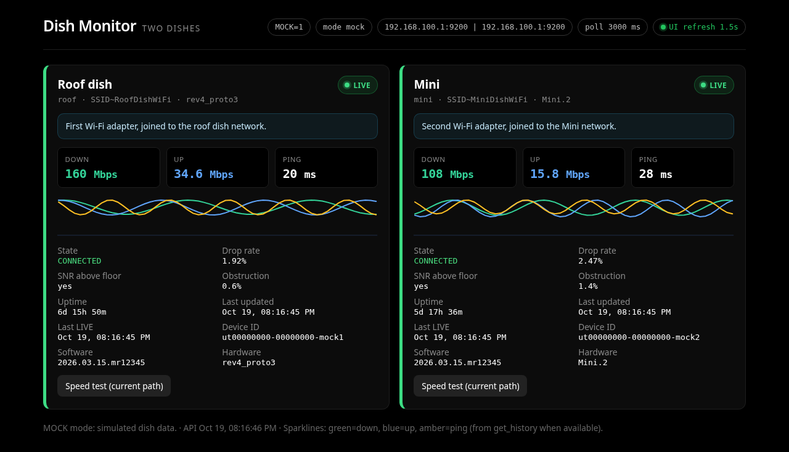

# Dish Monitor

[](https://github.com/jasondmillwood/dish-monitor/actions/workflows/ci.yml)




A small self-hosted dashboard for **one or two Starlink-compatible dishes**. It shows live state, down/up throughput, ping, drop rate, obstruction, uptime and a short sparkline for each dish, refreshed every few seconds.

> Unofficial. Not affiliated with, endorsed by or sponsored by SpaceX or Starlink. "Starlink" is used only to say which hardware this works with. It reads the dish's local, undocumented status API, which can change with any firmware update.

- One dish: works on any machine that can reach the dish (Wi-Fi or Ethernet).
- Two dishes: both dishes answer on the same address (`192.168.100.1`), so the machine needs **one network adapter per dish**. Dish Monitor binds each dish's traffic to its own adapter, and both cards stay LIVE.
- With two dishes but one adapter, the dish you're connected to is LIVE and the other shows its last-known values (STALE).
- Read-only: it never changes dish settings.

## Install (Linux, one command)

Needs Node.js 20 or newer and a systemd user session. No root.

```bash
# one dish
curl -fsSL https://raw.githubusercontent.com/jasondmillwood/dish-monitor/v0.1.1/install.sh | bash -s -- --dishes 1

# two dishes, one Wi-Fi adapter each (find names with: ip -br link)
curl -fsSL https://raw.githubusercontent.com/jasondmillwood/dish-monitor/v0.1.1/install.sh | bash -s -- --dishes 2 --iface1 wlan0 --iface2 wlan1
```

Then open `http://localhost:8787`.

Prefer not to pipe to bash? Download `install.sh`, read it, then run it with the same options. From a local checkout: `git clone https://github.com/jasondmillwood/dish-monitor && cd dish-monitor && ./install.sh --source . --dishes 1`.

| Option | Meaning |
|---|---|
| `--dishes 1\|2` | number of dishes (default 1) |
| `--iface1`, `--iface2` | network adapter for each dish (needed for two LIVE dishes) |
| `--port N`, `--host ADDR` | listen port (8787) and address (`0.0.0.0` = your LAN; `127.0.0.1` = this machine only) |
| `--watchdog` | also install a timer that rejoins a dish Wi-Fi after a dish reboot (NetworkManager) |
| `--mock` | demo mode with simulated dishes |
| `--dry-run` | print every step and file, change nothing |
| `--uninstall [--purge]` | remove the service and code; `--purge` also deletes config and data |

Locations: code `~/.local/share/dish-monitor`, config `~/.config/dish-monitor/config.json` (mode 600, never overwritten on upgrade), data `~/.local/state/dish-monitor`, service `dish-monitor.service` (`systemctl --user status dish-monitor`).
To keep it running after you log out: `loginctl enable-linger $USER`.

## Configuration

Every setting is in one file, `config.json`. Examples: `config.example.json` (one dish) and `config.two-dish.example.json` (two dishes).

| Field | Meaning |
|---|---|
| `title`, `subtitle` | header text |
| `pollIntervalMs` | how often dishes are polled (default 3000) |
| `mode` | `auto` (dual when both dishes have an adapter), `dual` or `single` |
| `dishes[]` | 1 or 2 entries, shown in this order |
| `dishes[].slot` | short id, `a-z 0-9 _ -` (used in URLs and data file names) |
| `dishes[].label` | name on the card |
| `dishes[].kind` | optional `standard` or `mini`; helps one-adapter mode tell two dishes apart |
| `dishes[].deviceId` | optional: pin a slot to a dish id (shown on the card once seen) |
| `dishes[].address` | dish address, normally `192.168.100.1:9200` |
| `dishes[].interface` | adapter name, e.g. `wlan0` (two-dish setups) |
| `dishes[].localAddress` | Windows/macOS only: that adapter's IPv4, used when no interface is set |
| `dishes[].ssidHint`, `wifiHint` | optional text shown on the card |

Environment overrides: `CONFIG_PATH`, `DATA_DIR`, `PORT`, `HOST`, `POLL_MS`, `MODE`, `MOCK=1`, `DISHn_IFACE`, `DISHn_ADDR`, `DISHn_LOCAL_ADDR`, `PROXY_BASE_PORT` (default 19001).

### Wi-Fi watchdog (optional)
`~/.config/dish-monitor/watchdog.conf` has one line per dish: the NetworkManager connection name, a TAB, then the adapter. For example: `Roof dish wifi<TAB>wlan0`. List connection names with `nmcli -t -f NAME,DEVICE con show`.

## How two dishes on one machine work
Each dish gets a local proxy (`127.0.0.1:19001`, `:19002`). The proxy opens its upstream connection bound to that dish's adapter with `SO_BINDTODEVICE`. Linux 5.7+ allows this without root.
If the bind is refused, the proxy uses the adapter's *current* IPv4 as the source address. That address is looked up on every connect, so DHCP changes don't break it.
Check `/api/config` to see which method each dish uses.

**Policy routing (optional, root):** `scripts/linux-dual-nic-routes.sh` is an alternative based on routes. Read it first, then run it yourself with `sudo -E` and `DISH1_IFACE/DISH1_GW/DISH1_LOCAL` and `DISH2_…` set. The installer never runs it.

## API
`GET /api/status` (all dishes), `/api/config`, `/api/dishes/<slot>`, `/api/dish/<slot>/history` (the dish's raw recent history, for loggers), `/api/health`.
The API has no login, so keep it on your LAN or a private VPN. Don't expose it to the internet.
There are no CORS headers, so web pages on other sites can't read it; the built-in UI and server-side clients are unaffected.

`/api/dish/<slot>/history` asks the dish at most once per `HISTORY_MIN_INTERVAL_MS` (default 10 s) per dish; other callers get the cached copy (`cached: true`, `fetchedAt` = when the dish answered). Each client may call it `HISTORY_RATE_MAX` (30) times per `HISTORY_RATE_WINDOW_MS` (60 s) per dish, then gets `429` with `Retry-After` (loopback and `HISTORY_RATE_EXEMPT=ip,ip` are never limited). A dish that can't be reached gives `503 {"away": true}`.
The poller refreshes the sparkline from history every `HISTORY_POLL_MS` (30 s) and keeps each status call inside the poll interval. A dish that says it's connected but reports 0 for everything is flagged `schemaSuspect` (firmware may have moved the fields) and logged once.
Logging: `LOG_LEVEL=debug` shows per-poll lines; the default prints a summary every 10 minutes. `FASTIFY_LOG=info` turns request logs on.

## Development
```bash
npm ci
MOCK=1 npm run dev      # API :8787 + UI :5173
npm run build && npm start   # production: node dist/server/index.js
npm test                # unit, server (1 and 2 dishes), client and installer tests
python3 scripts/public-scrub.py --history .   # no private IPs / tokens in tree or history
npm run typecheck
```

The **Speed test** button on a card runs in your browser against Cloudflare's public speed endpoint. It measures your current internet path, not the dish API, and runs only when you press it.

## License
MIT; see `LICENSE`. Third-party packages and their licenses are listed in `THIRD_PARTY_LICENSES` (all runtime packages are permissive).
Contributing: `CONTRIBUTING.md`. Security reports: `SECURITY.md`.
